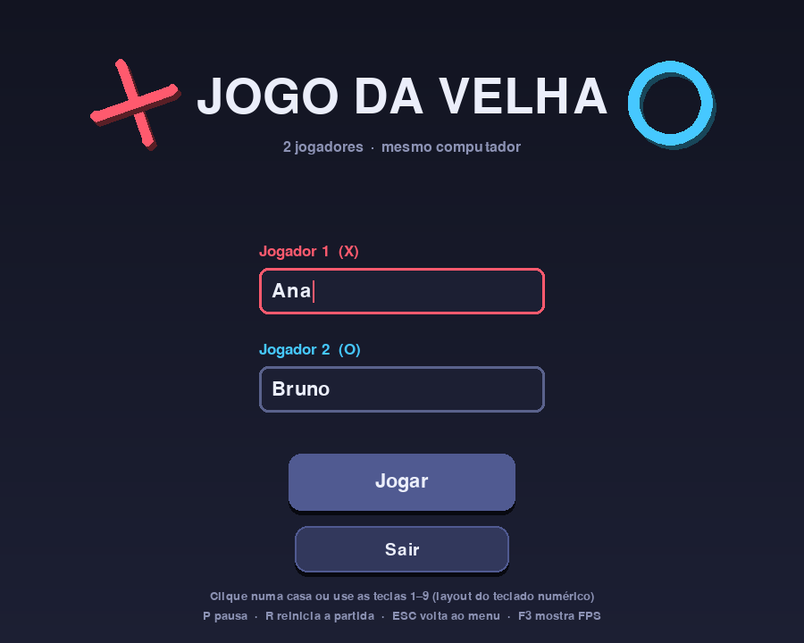
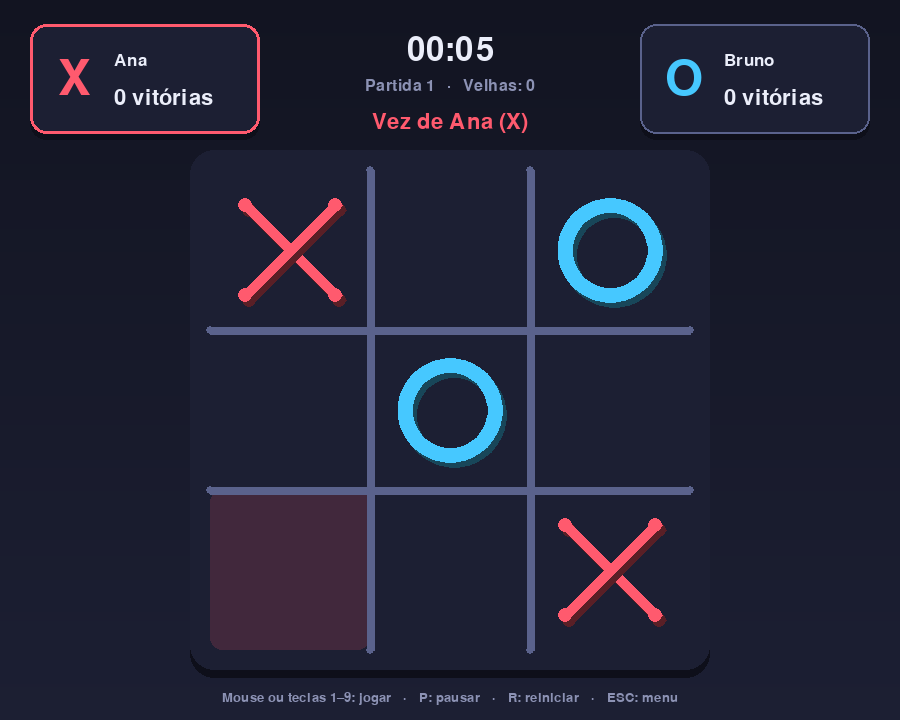
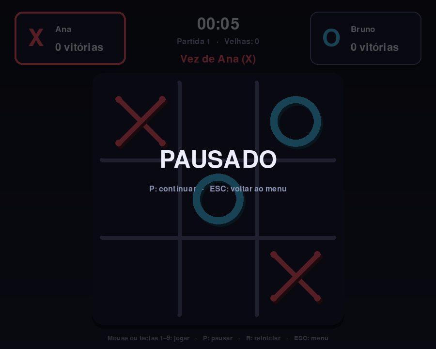
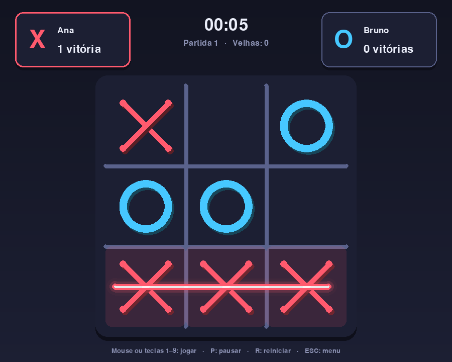
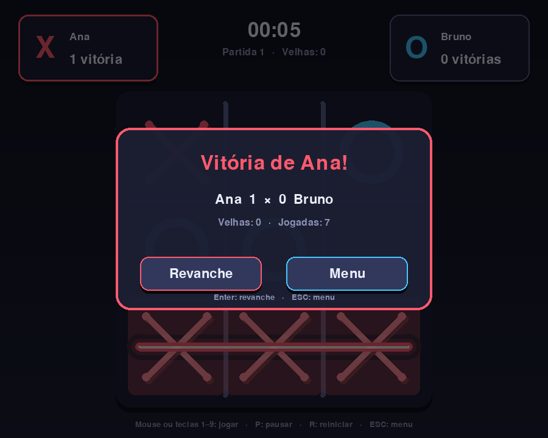
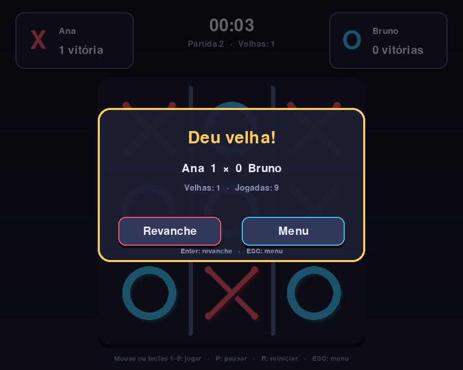

# 2. Prototipação e Design de Telas (UI/UX)

Janela fixa de **900 x 720 px**. As três telas exigidas são descritas abaixo, cada uma com wireframe e captura da implementação.

## 2.1 Tela de Menu Inicial

Identifica os jogadores e apresenta os controles (RF01, RNF06).

```
+--------------------------------------------------------------+
|   (X girando)        JOGO DA VELHA          (O pulsando)     |
|                2 jogadores · mesmo computador                |
|                                                              |
|                 Jogador 1 (X)                                |
|                 [ Ana______________________ ]                |
|                 Jogador 2 (O)                                |
|                 [ Bruno____________________ ]                |
|                                                              |
|                       [    Jogar    ]                        |
|                       [    Sair     ]                        |
|   Clique numa casa ou use as teclas 1–9 (layout numpad)      |
|   P pausa · R reinicia · ESC volta ao menu · F3 mostra FPS   |
+--------------------------------------------------------------+
```



## 2.2 Tela Principal da Partida

HUD com placar, indicador de vez, cronômetro e área jogável (RF02, RF07, RF11).

```
+--------------------------------------------------------------+
| +------------+            00:05             +------------+   |
| | X  Ana     |      Partida 1 · Velhas: 0   | O  Bruno   |   |
| |  0 vitórias|        Vez de Ana (X)        |  0 vitórias|   |
| +------------+  (cartão da vez com borda    +------------+   |
|                  pulsante na cor do jogador)                 |
|              +-------+-------+-------+                       |
|              |   X   |       |   O   |                       |
|              +-------+-------+-------+                       |
|              |       |   O   |       |                       |
|              +-------+-------+-------+                       |
|              |(hover)|       |   X   |                       |
|              +-------+-------+-------+                       |
|  Mouse ou 1–9: jogar · P: pausar · R: reiniciar · ESC: menu  |
+--------------------------------------------------------------+
```



**Estados auxiliares**

- **Pausa:** overlay escuro com "PAUSADO". As jogadas e o cronômetro ficam bloqueados (RF08).
- **Fechamento da linha vencedora:** linha brilhante com pulso, células destacadas e partículas (RF12).




## 2.3 Tela de Fim de Jogo

É um painel sobreposto à partida que entra com animação de escala e fade (RF10).

```
+--------------------------------------------------------------+
|        +--------------------------------------------+        |
|        |            Vitória de Ana!                 |        |
|        |           Ana  1  ×  0  Bruno              |        |
|        |        Velhas: 0  ·  Jogadas: 7            |        |
|        |   [ Revanche ]            [  Menu  ]       |        |
|        |      Enter: revanche · ESC: menu           |        |
|        +--------------------------------------------+        |
+--------------------------------------------------------------+
```

| Vitória | Velha |
|---|---|
|  |  |

## 2.4 Justificativa gráfica

**Paleta de cores**

| Uso | Cor | Justificativa |
|---|---|---|
| Fundo | `#121421` → `#1C1F33` (gradiente) | Tom escuro e frio que reduz o cansaço visual e dá contraste aos símbolos luminosos. |
| Jogador 1 (X) | `#FF5A6E` vermelho/rosa | Cor quente, facilmente distinguível do O. |
| Jogador 2 (O) | `#46C8FF` ciano | Cor fria e complementar ao X. Mesmo com daltonismo vermelho-verde, X e O seguem diferenciados também pela **forma**. |
| Grade | `#5A628C` | Neutra e de menor saliência, para não competir com os símbolos. |
| Velha | `#FACD5A` âmbar | Neutra em relação aos dois jogadores. |
| Erro | `#FF3C3C` | Flash curto em jogada inválida. |

**Tipografia:** usamos a fonte padrão do Pygame (sans-serif embutida), o que garante portabilidade (RNF02). A hierarquia de tamanhos é 72 (título), 48 (cronômetro e resultado), 32 (nomes e botões) e 24/20 (informações secundárias).

**Ergonomia para 2 jogadores**

- Cada jogador tem um cartão fixo no seu lado da tela (P1 à esquerda, P2 à direita), na cor do próprio símbolo.
- A vez é indicada de forma redundante: borda pulsante no cartão, texto "Vez de ..." na cor do jogador e realce da casa sob o mouse nessa mesma cor.
- Os controles são compartilhados (mouse ou teclas 1–9 no layout do teclado numérico), pois o jogo é por turnos. Não há conflito de teclas entre os jogadores.
- O feedback de erro é imediato (tremor e flash) e não altera o turno.
- As animações de traçado são curtas (≈ 0,35 s) e não bloqueiam a próxima jogada.
