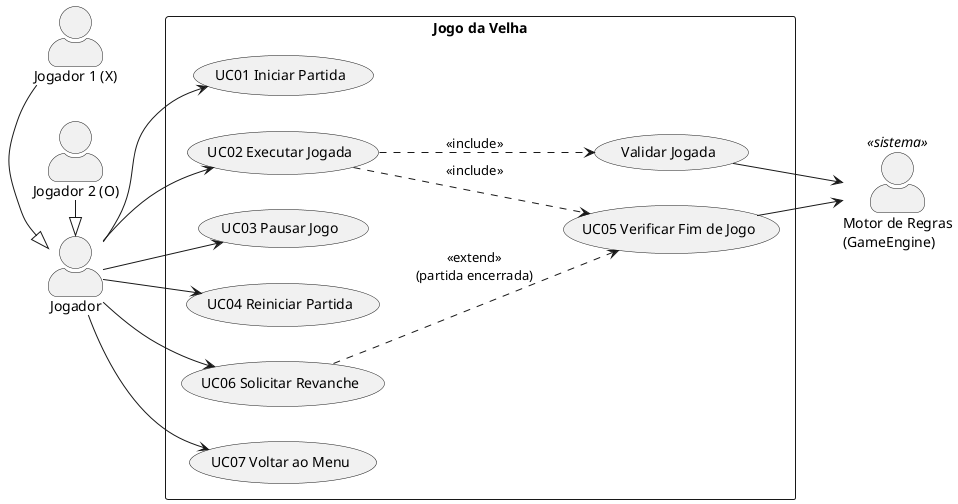

# 3. Modelagem de Casos de Uso

> Os diagramas estão em **PlantUML**. Para gerar a imagem, use a extensão *PlantUML* do VS Code ou cole o bloco em <https://www.plantuml.com/plantuml>.

## 3.1 Diagrama de Casos de Uso

## 3.2 Especificação dos casos de uso principais

### UC01 — Iniciar Partida

| Item | Descrição |
|---|---|
| Atores | Jogador 1, Jogador 2 |
| Pré-condições | Aplicação aberta na tela de menu. |
| Pós-condições | `GameEngine` criado com os dois jogadores, tabuleiro vazio, estado `PLAYING` e vez de X. |
| Fluxo principal | 1. O sistema exibe os campos de nome e os controles. 2. O Jogador 1 digita seu nome. 3. O Jogador 2 digita seu nome (`Tab` alterna o campo). 4. Um jogador clica em **Jogar** ou pressiona `Enter`. 5. O sistema cria os jogadores (X e O) e abre a tela da partida, animando o traçado da grade. |
| Fluxos alternativos | A1. Nome vazio: o sistema atribui "Jogador 1" ou "Jogador 2". A2. Nome com mais de 14 caracteres: os caracteres excedentes são ignorados. |
| Fluxos de exceção | E1. O jogador clica em **Sair** ou pressiona `ESC`: a aplicação é encerrada. |

### UC02 — Executar Jogada

| Item | Descrição |
|---|---|
| Atores | Jogador da vez; Motor de Regras |
| Pré-condições | Partida em andamento (`PLAYING`). |
| Pós-condições | Casa marcada com o símbolo do jogador e turno passado ao adversário (ou partida encerrada). |
| Fluxo principal | 1. O jogador clica numa casa ou pressiona uma tecla de 1 a 9. 2. A `GameScene` converte a posição de tela em célula (`BoardLayout.cell_from_screen`). 3. O Motor de Regras valida a jogada (include *Validar Jogada*). 4. O tabuleiro marca a célula. 5. O sistema inclui UC05. 6. Sem fim de jogo, o turno passa ao adversário. 7. O símbolo é desenhado com animação de traçado e partículas. |
| Fluxos alternativos | A1. Jogada pelo teclado: a tecla é convertida em célula pelo layout do teclado numérico. A2. A jogada encerra a partida: segue para UC05 e o turno não é alternado. |
| Fluxos de exceção | E1. **Casa ocupada:** retorna `INVALID_OCCUPIED`, a casa treme e pisca em vermelho e o turno não muda. E2. **Clique fora do tabuleiro:** é ignorado. E3. **Tentativa de jogar fora do turno**, com o jogo pausado (`PAUSED`) ou encerrado (`GAME_OVER`): a jogada é rejeitada. Como o turno é controlado pelo motor, um jogador só consegue marcar o próprio símbolo na sua vez. |

### UC03 — Pausar Jogo

| Item | Descrição |
|---|---|
| Atores | Jogador |
| Pré-condições | Partida em andamento. |
| Pós-condições | Estado `PAUSED`, com cronômetro congelado e jogadas bloqueadas. |
| Fluxo principal | 1. O jogador pressiona `P` ou `ESC`. 2. O sistema muda o estado para `PAUSED` e mostra o overlay "PAUSADO". 3. O jogador pressiona `P` novamente. 4. O sistema volta para `PLAYING`. |
| Fluxos alternativos | A1. Com o jogo pausado, `ESC` leva ao menu (UC07). |
| Fluxos de exceção | E1. Pausa solicitada com a partida encerrada: é ignorada. |

### UC04 — Reiniciar Partida

| Item | Descrição |
|---|---|
| Atores | Jogador |
| Pré-condições | Tela da partida ativa. |
| Pós-condições | Tabuleiro vazio, mesmo jogador inicial, placar mantido e cronômetro zerado. |
| Fluxo principal | 1. O jogador pressiona `R`. 2. O sistema limpa o tabuleiro, os símbolos, as partículas e os efeitos. 3. A partida recomeça com o mesmo jogador inicial. |
| Fluxos de exceção | — |

### UC05 — Verificar Fim de Jogo

| Item | Descrição |
|---|---|
| Atores | Motor de Regras |
| Pré-condições | Uma jogada válida acabou de ser registrada. |
| Pós-condições | Estado `WIN` (com vencedor, linha vencedora e placar atualizado), `DRAW` (velhas + 1) ou inalterado. |
| Fluxo principal | 1. O motor percorre as 8 linhas vencedoras. 2. Se encontra uma linha completa, define o estado `WIN`, registra o vencedor e a linha e soma 1 ao placar do vencedor. 3. A cena cria o `WinLineEffect`: traçado da linha, brilho e partículas. 4. Depois do efeito, exibe o painel de fim de jogo. |
| Fluxos alternativos | A1. Tabuleiro cheio sem linha completa: estado `DRAW`, velhas + 1, partículas âmbar e painel "Deu velha!". A2. Nenhuma das condições: a partida continua. |

### UC06 — Solicitar Revanche

| Item | Descrição |
|---|---|
| Atores | Jogador |
| Pré-condições | Painel de fim de jogo visível. |
| Pós-condições | Nova partida com o outro jogador começando e placar acumulado mantido. |
| Fluxo principal | 1. O jogador clica em **Revanche** ou pressiona `Enter`, `R` ou `Espaço`. 2. O motor alterna o jogador inicial e limpa o tabuleiro. 3. O número da partida aumenta em 1. |

### UC07 — Voltar ao Menu

| Item | Descrição |
|---|---|
| Atores | Jogador |
| Pré-condições | Jogo pausado ou encerrado. |
| Pós-condições | Tela de menu exibida com os nomes atuais já preenchidos. |
| Fluxo principal | 1. O jogador clica em **Menu** ou pressiona `ESC`. 2. O sistema abre o menu. |
