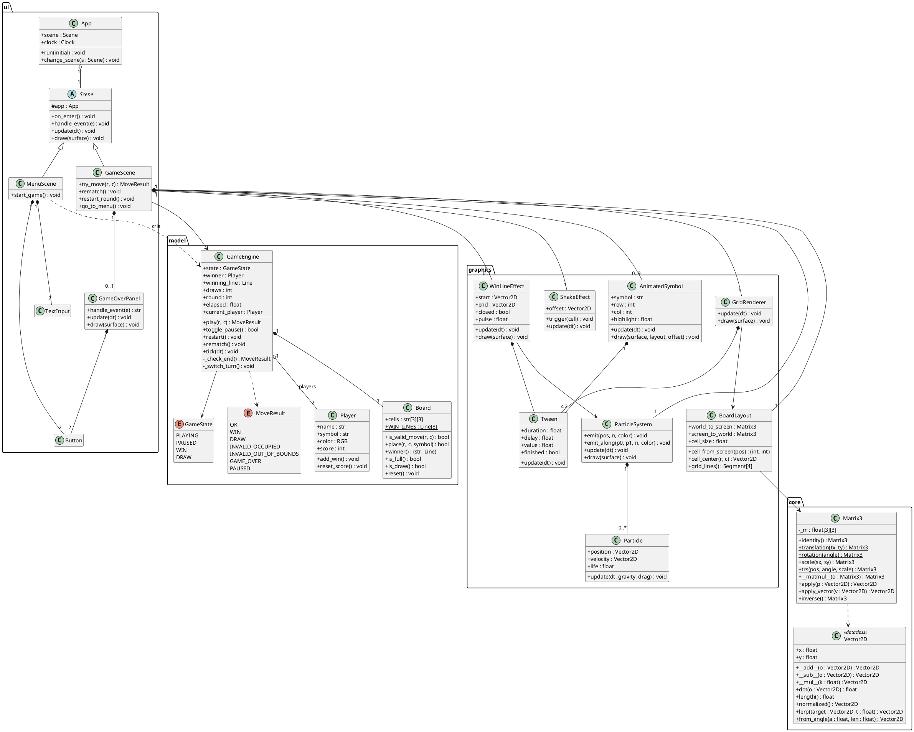
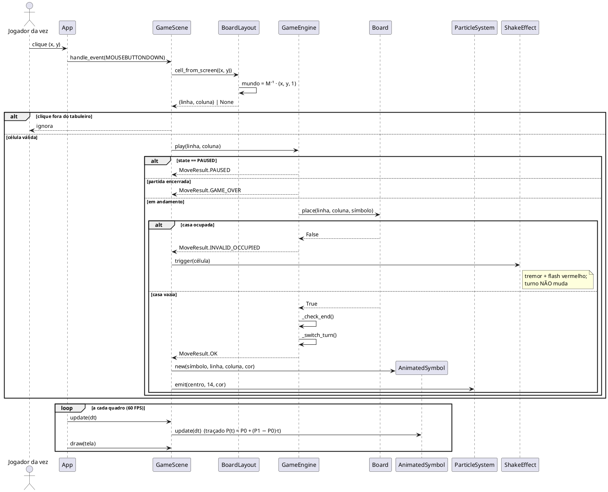
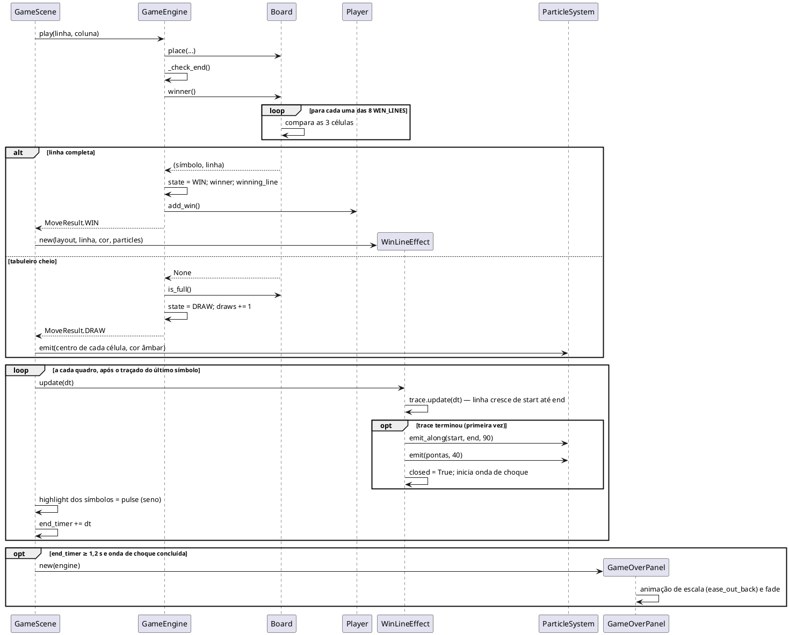

# 4. Modelagem Estrutural e Dinâmica

> Os diagramas estão em **PlantUML**. Para gerar as imagens, use a extensão *PlantUML* do VS Code ou <https://www.plantuml.com/plantuml>.

## 4.1 Diagrama de Classes

A arquitetura tem três camadas:

- **core**: matemática de computação gráfica.
- **model**: regras do jogo, sem dependência do Pygame.
- **graphics/ui**: apresentação.

As dependências apontam sempre da apresentação para o modelo.

## 4.2 Diagrama de Sequência 1 — Processamento e validação de uma jogada

## 4.3 Diagrama de Sequência 2 — Verificação de fim de jogo e animação de vitória

